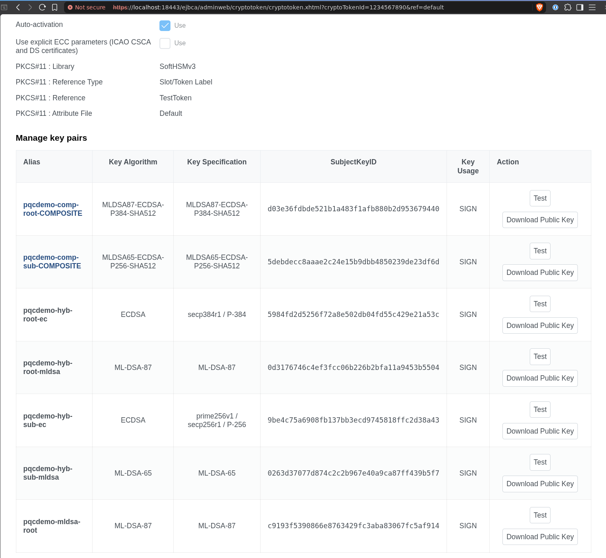
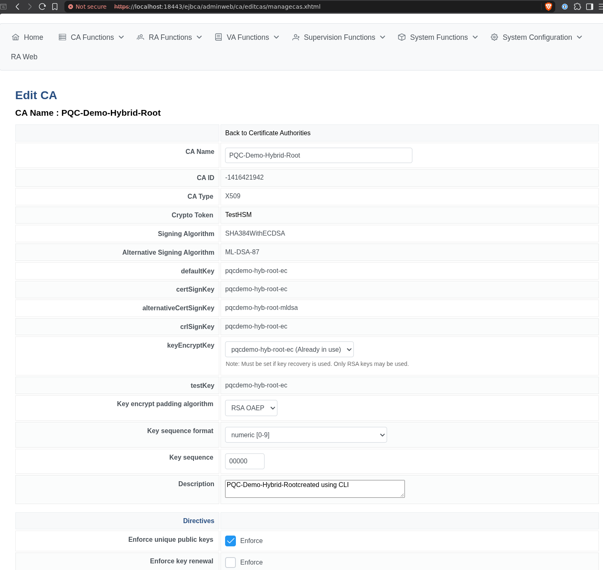
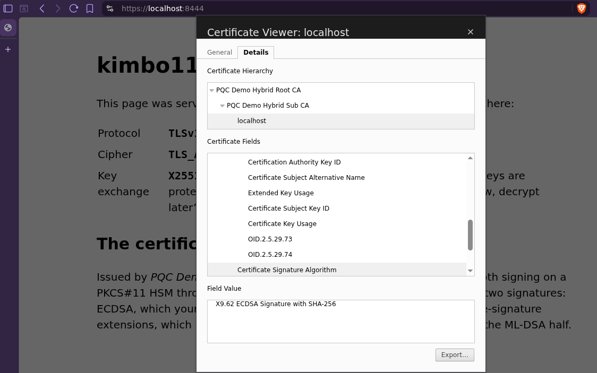
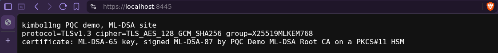
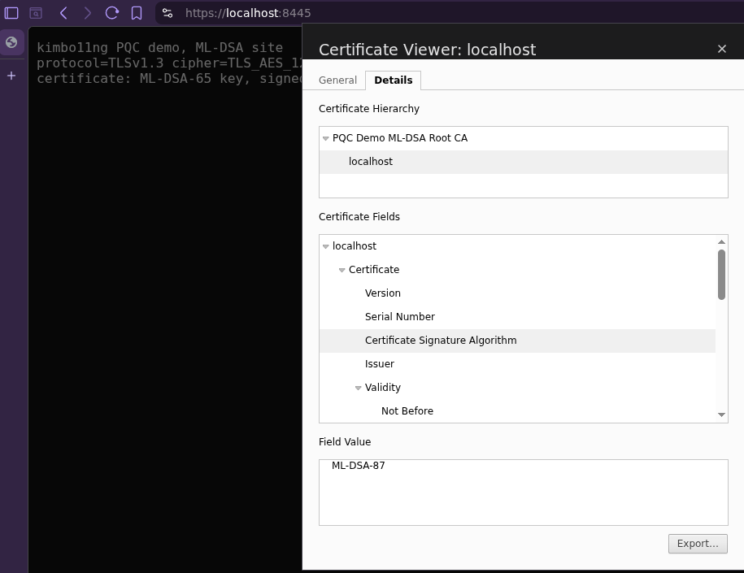

# PQC demo: what works with post-quantum certificates today

A walk-through for the dev stack. It builds three certificate hierarchies, with every CA key on the
SoftHSMv3 token through kimbo11ng, and puts each one in front of the verifiers that exist today.
The results below were measured on 2026-11-08 with EJBCA CE 9.6.3, BouncyCastle 1.84,
OpenSSL 3.5.9, curl 8.22 and nginx 1.31 (built with OpenSSL 3.5.9), and, by hand, with Brave 1.98.63
(Chromium 156.0.8078.80) on Linux. `just demo-check` measures all but the browser again on your
machine and flags any line that has changed.

## Run it

```bash
just up            # the dev stack, if it is not running
just create-token  # the TestHSM crypto token the demo's keys go on; skipped if it exists
just demo          # demo-seed, demo-web, demo-check
```

| Recipe | What it does |
| --- | --- |
| `just demo-seed` | Generates the keys on `TestHSM`, creates the CAs and certificates, and exports them to `.demo/pqc/`. Safe to re-run: anything that exists is left alone. |
| `just demo-web` | Starts nginx (compose profile `demo`) with a hybrid site on `https://localhost:8444/` and an ML-DSA site on `https://localhost:8445/`. Set `PQC_DEMO_HTTPS_PORT` / `PQC_DEMO_MLDSA_PORT` to move them. |
| `just demo-check` | Verifies every chain with BouncyCastle and OpenSSL, and over a live TLS connection to each site. |

It needs Docker, Java 21, Maven and OpenSSL 3.5 or later on the host. The BouncyCastle half of the
checks is `scripts/demo/PqcDemo.java`, run with the BouncyCastle jars Maven already resolved for
the build.

## What gets created

| Hierarchy | Root CA | Sub CA | End entities |
| --- | --- | --- | --- |
| Hybrid | `PQC-Demo-Hybrid-Root`: ECDSA P-384, plus ML-DSA-87 as alternative signature | `PQC-Demo-Hybrid-Sub`: ECDSA P-256, plus ML-DSA-65 | web certificate for `localhost` |
| Composite | `PQC-Demo-Composite-Root`: MLDSA87-ECDSA-P384-SHA512 | `PQC-Demo-Composite-Sub`: MLDSA65-ECDSA-P256-SHA512 | web certificate for `localhost` |
| ML-DSA | `PQC-Demo-MLDSA-Root`: ML-DSA-87 | none | web certificate for `localhost` (ML-DSA-65 key), document-signing certificate (ML-DSA-65 key) and a signed document |

All six CAs appear in the EJBCA admin UI under *Certification Authorities*, and their keys under
*Crypto Tokens → TestHSM*. The aliases start with `pqcdemo-`.



*The demo's CA keys on `TestHSM`, as EJBCA lists them. Each composite key shows as one alias, which
EJBCA assembles from its `-COMPQ` and `-COMPC` halves. Every key reports SIGN only. Before
`kimbo11ng.keygen.restrictUsages`, SoftHSMv3 marked these keys for encryption as well, and EJBCA
showed them as SIGN_ENCRYPT. The* Not secure *in the address bar refers to the admin UI's own
self-signed certificate.*

A hybrid CA is EJBCA's own configuration, not a workaround. Its edit page shows the alternative
algorithm and key next to the classical ones:



The hybrid and composite web certificates carry an RSA-2048 key, because EJBCA's `batch` tool
generates one by default. Only the signatures of the CAs above them are post-quantum. The ML-DSA web
and signing keys are generated on the host by `PqcDemo.java` and certified from a CSR.

## The three verdicts

| | BouncyCastle | OpenSSL 3.5 | TLS server (nginx) | TLS client (curl, OpenSSL) | Browser |
| --- | --- | --- | --- | --- | --- |
| **Hybrid** | ✅ both signatures | ✅ ECDSA signatures | ✅ | ✅ | ✅ Brave 1.98.63, on the ECDSA signatures; the ML-DSA half is ignored |
| **Composite** | ✅ | ❌ cannot decode the key | ❌ will not load the chain | ❌ | ❌ no server can serve it |
| **ML-DSA** | ✅ | ✅ | ✅ | ✅ `mldsa65` handshake signature | ✅ Brave 1.98.63 (Chromium 156), once the root is trusted; other browsers not tested |

Every TLS connection in the demo also negotiates the **X25519MLKEM768** key exchange, which nginx
and OpenSSL 3.5 offer by default and current browsers support. The hybrid page shows the group its
own connection used.

### 1. Hybrid: deployable today

Open `https://localhost:8444/` after trusting `.demo/pqc/hybrid-root.pem` (or accept the warning).
The page reports *Key exchange: X25519MLKEM768*. The browser has verified the chain on its ECDSA
signatures.



*Brave 1.98.63 on the hybrid site, 2026-11-08: no warning, the full chain built, and the signature
read as ECDSA with SHA-256. The ML-DSA half is there. Brave does not recognise it and lists the
two alternative-signature extensions by number, `OID.2.5.29.73` and `OID.2.5.29.74`.*

Each certificate also carries an ML-DSA signature in the X.509 alternative-signature extensions
(`altSignatureAlgorithm`, `altSignatureValue`). Each CA certificate publishes its own ML-DSA key in
`subjectAltPublicKeyInfo`. Browsers skip that half. `demo-check` verifies it with BouncyCastle:

```
ok   ML-DSA alternative signature: sub by root    (ML-DSA-87)
ok   ML-DSA alternative signature: web by sub     (ML-DSA-65)
```

### 2. Composite: issued, but nothing consumes it

EJBCA and kimbo11ng issue the whole chain, and BouncyCastle validates it. OpenSSL cannot decode a
composite public key, so `openssl verify` fails, and an OpenSSL-based server such as nginx, Apache
or HAProxy refuses to load the chain at all. `demo-check` expects both failures and reports them as
`fails`. In TLS, the signatures in a certificate chain must use a scheme both sides negotiated, and
no TLS stack defines one for composites yet. BouncyCastle's own JSSE 1.84 rejects the chain for
that reason too.

### 3. ML-DSA: post-quantum end to end, browser included

```bash
curl --cacert .demo/pqc/mldsa-root.pem https://localhost:8445/
```

The handshake is post-quantum on both counts. The server signs with `mldsa65` and the key exchange
is X25519MLKEM768. OpenSSL 3.5 handles it on both sides.

A browser can too. Brave 1.98.63 (Chromium 156.0.8078.80) on Linux, with no experimental flags,
completed the same handshake. Once `.demo/pqc/mldsa-root.pem` was imported as a trusted authority,
it validated the ML-DSA chain and showed the connection as secure:



*The ML-DSA site in a private Brave window, 2026-11-08. The address bar shows no warning, and the
page reports the X25519MLKEM768 key exchange its own connection negotiated.*



*The same connection's certificate: Brave built the chain to the imported root, and reads the
signature on the server certificate as ML-DSA-87.*

Two things to know when you try it:

- Import the root before the first visit. If you click through the warning first, Chromium remembers
  that exception for the site, even across restarts, and keeps showing *Not secure* after the
  import. A private window starts without the exception.
- The root is a private one. Whether a publicly trusted CA may issue ML-DSA certificates, and
  whether root programs accept them, is a separate question this demo does not answer.

Outside TLS, the demo signs `document.txt` as CMS, and both BouncyCastle and OpenSSL verify the
signature and its chain.

## What you can claim, and what not

- ✅ *Our sessions are protected against harvest-now, decrypt-later*: the key exchange is
  X25519MLKEM768.
- ✅ *Our CA issues hybrid, composite and ML-DSA certificates, with keys on an HSM*.
- ✅ *Hybrid certificates can be deployed today*: every client accepts them, and the ML-DSA
  signatures can be verified by whoever checks them.
- ✅ *Our internal services authenticate with ML-DSA*, if both ends run OpenSSL 3.5 or later.
- ✅ *A current browser can authenticate a site with ML-DSA*: Brave 1.98.63 (Chromium 156) does,
  against a root you trust. Measured with that browser only.
- ❌ *Our public web server authenticates with post-quantum signatures*: that needs a publicly
  trusted CA issuing ML-DSA certificates, which this demo does not test. With a hybrid
  certificate, browsers verify only the classical half.
- ❌ *Composite certificates are ready for TLS*: no TLS stack accepts them yet.

## Notes

- **Demo only.** The private keys of the ML-DSA end entities, and of the web certificates (which
  come from PKCS#12 files), sit unencrypted in `.demo/pqc/`, which git ignores.
- **Rebuilding.** Deleting `.demo/pqc/` and running `just demo-seed` again re-issues the
  certificates. The keys and CAs on the token stay where they are. `docker compose down -v`
  removes everything, including every other key on `TestHSM`.
- **Hybrid CAs.** They are created with EJBCA's own `ca init --altsigalg` and the
  `alternativeCertSignKey` token property. A CA certificate created by patching the database
  instead carries the alternative signature but not `subjectAltPublicKeyInfo`, so its ML-DSA half
  cannot be verified.
